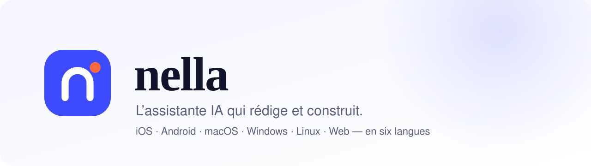
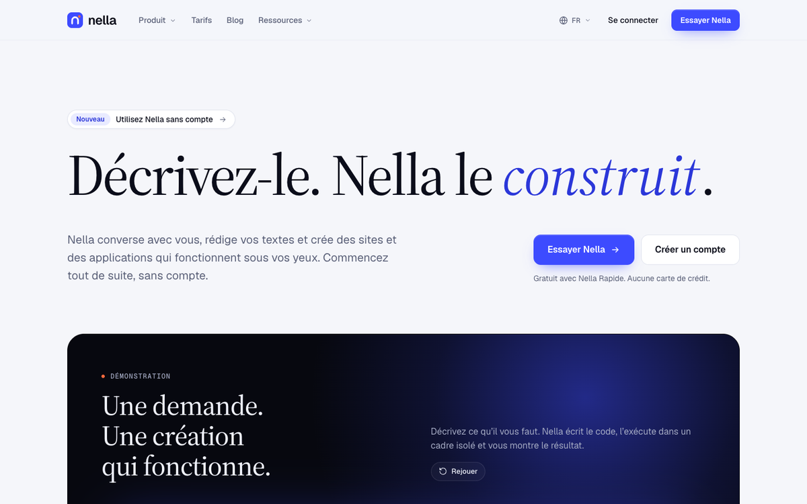
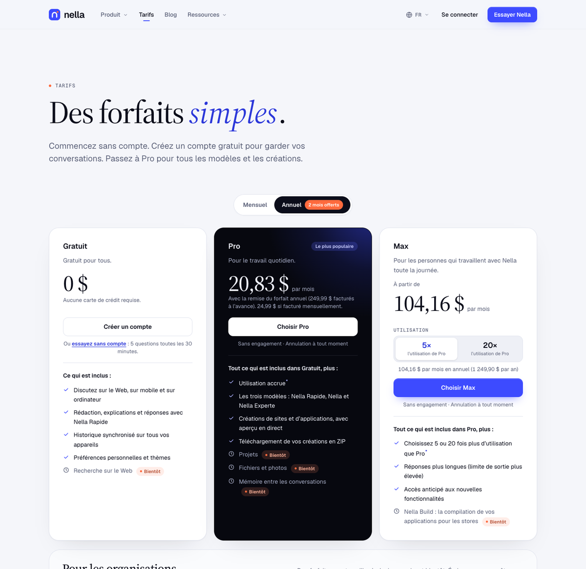
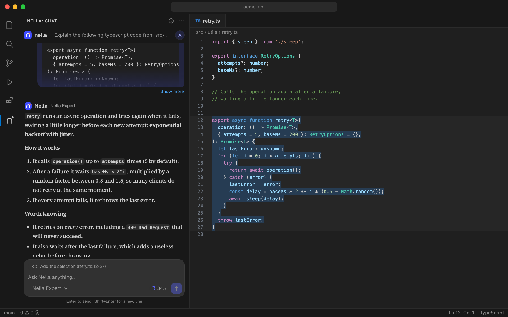

<div align="center">

<picture>
  <source media="(prefers-color-scheme: dark)" srcset="docs/assets/banner-dark.svg">
  
</picture>

<p>
  <a href="https://nellacorp.com"><strong>nellacorp.com</strong></a> ·
  <a href="https://nellacorp.com/fr/download">Télécharger</a> ·
  <a href="https://nellacorp.com/app">Essayer en ligne</a> ·
  <a href="https://nellacorp.com/fr/pricing">Tarifs</a> ·
  <a href="https://github.com/santana237/nella/issues/new/choose">Signaler un problème</a> ·
  <a href="#english">English</a>
</p>

<p>
  <a href="https://nellacorp.com/fr/download/ios"></a>
  <a href="https://nellacorp.com/fr/download/android"></a>
  <a href="https://nellacorp.com/fr/download/mac"></a>
  <a href="https://nellacorp.com/fr/download/windows"></a>
  <a href="https://nellacorp.com/fr/download/linux"></a>
  <a href="https://nellacorp.com/app"></a>
  <a href="https://nellacorp.com/fr/download/vscode"></a>
</p>

<p>
  <a href="https://github.com/santana237/nella/releases/latest"></a>
  
  
</p>

</div>

**Nella** est une assistante IA professionnelle de **Nella Group**. Elle répond, rédige, cherche sur le Web en citant ses sources et **construit des sites et des applications** qu’on voit tourner en direct. Elle est disponible sur **iPhone, Android, Mac, Windows, Linux, le Web et VS Code**, en six langues : français, anglais, espagnol, portugais, allemand et arabe.

Ce dépôt est la **vitrine publique** de Nella : téléchargements, notes de version et signalement des problèmes. Le code source n’y est pas publié.

---

## Télécharger

| | Plateforme | Téléchargement | Statut |
|---|---|---|---|
|  | **iPhone et iPad** (iOS 15+) | App Store | Examen d’Apple en cours |
|  | **Android** (7.0+) | [APK](https://github.com/santana237/nella/releases/latest) · [nellacorp.com](https://nellacorp.com/fr/download/android) | Disponible · Google Play bientôt |
|  | **Mac** (Apple Silicon, macOS 12+) | [DMG](https://github.com/santana237/nella/releases/latest) · [nellacorp.com](https://nellacorp.com/fr/download/mac) | Disponible, notarisé par Apple · Mac App Store bientôt |
|  | **Windows** (10+) | [Installateur .exe](https://github.com/santana237/nella/releases/latest) · [nellacorp.com](https://nellacorp.com/fr/download/windows) | Disponible · mises à jour automatiques |
|  | **Linux** x64 (Ubuntu 22.04+) | [AppImage, .deb](https://github.com/santana237/nella/releases/latest) · [nellacorp.com](https://nellacorp.com/fr/download/linux) | Disponible · Flathub bientôt |
|  | **Web** | [nellacorp.com/app](https://nellacorp.com/app) | Disponible, sans installation |
|  | **VS Code** et éditeurs compatibles | [.vsix](https://github.com/santana237/nella/releases/latest) · [nellacorp.com](https://nellacorp.com/fr/download/vscode) | Disponible · Marketplace et Open VSX bientôt |

Les applications se mettent à jour d’elles-mêmes, chacune par le circuit de sa plateforme. Un compte gratuit suffit pour commencer, et on peut aussi essayer **sans compte**.

<details>
<summary><strong>Vérifier un téléchargement</strong></summary>

Chaque version publie un fichier `SHA256SUMS.txt`. Sur Mac ou Linux :

```sh
shasum -a 256 -c SHA256SUMS.txt --ignore-missing
```

L’app Mac est signée avec un identifiant de développeur Apple et notarisée. Les mises à jour des apps pour ordinateur sont signées (Ed25519) et vérifiées avant leur installation.

</details>

---

## Aperçu

<p align="center"></p>

| Site | Tarifs |
|---|---|
|  |  |
| **App Mac** | **Extension VS Code** |
|  |  |

---

## Ce que fait Nella

- **Conversations** en direct, avec trois niveaux : *Rapide*, *Nella* et *Experte* pour la réflexion approfondie.
- **Créations** : sites, pages et petites applications qui tournent dans l’app. On peut les prévisualiser, lire le code, le copier et l’exporter en ZIP.
- **Recherche Web** avec les sources citées.
- **Fichiers et photos** (images, PDF, textes), **projets** avec leurs propres instructions, **mémoire** que l’on peut consulter et modifier.
- **Lecture à voix haute**, dictée et plusieurs styles de réponse.
- **Extension VS Code** : expliquer, améliorer ou corriger du code, écrire des tests et rédiger les messages de commit.
- **Sans compte** : 20 messages toutes les 3 heures, créations comprises.
- **Abonnements** valables sur toutes les plateformes, payables par carte ou par Mobile Money (MTN et Orange).

## Signaler un problème ou proposer une idée

- 🐞 [Signaler un bug](https://github.com/santana237/nella/issues/new?template=bug_report.yml)
- 💡 [Proposer une idée](https://github.com/santana237/nella/issues/new?template=feature_request.yml)
- ✉️ Question sur un compte ou un paiement : **support@nellacorp.com**. N’écrivez jamais de mot de passe ni de numéro de carte dans un ticket public.
- 🔒 Faille de sécurité : voir [SECURITY.md](SECURITY.md). Ne la signalez pas dans un ticket public.

## Licence

Logiciel **propriétaire**, © 2026 **Nella Group**. Tous droits réservés. Les applications peuvent être téléchargées et utilisées selon les [Conditions d’utilisation](https://nellacorp.com/fr/legal/terms) et la [Politique de confidentialité](https://nellacorp.com/fr/legal/privacy). Voir [LICENSE](LICENSE).

---

<a id="english"></a>

## English

**Nella** is a professional AI assistant by **Nella Group**. It answers, writes, searches the web with cited sources and **builds websites and apps you can run instantly**. It is available on **iPhone, Android, Mac, Windows, Linux, the web and VS Code**, in six languages.

This repository is Nella’s **public home**: downloads, release notes and issue reports. The source code is not published here.

| Platform | Get it |
|---|---|
| iPhone and iPad | App Store (in review) |
| Android | [APK](https://github.com/santana237/nella/releases/latest) · [nellacorp.com](https://nellacorp.com/en/download/android) |
| Mac (Apple Silicon) | [Notarized DMG](https://github.com/santana237/nella/releases/latest) · [nellacorp.com](https://nellacorp.com/en/download/mac) |
| Windows | [.exe installer](https://github.com/santana237/nella/releases/latest) · [nellacorp.com](https://nellacorp.com/en/download/windows) |
| Linux x64 | [AppImage, .deb](https://github.com/santana237/nella/releases/latest) · [nellacorp.com](https://nellacorp.com/en/download/linux) |
| Web | [nellacorp.com/app](https://nellacorp.com/app) |
| VS Code | [.vsix](https://github.com/santana237/nella/releases/latest) · [nellacorp.com](https://nellacorp.com/en/download/vscode) |

Found a bug? [Open an issue](https://github.com/santana237/nella/issues/new/choose). For account or billing questions, write to **support@nellacorp.com**. Report security issues privately, as described in [SECURITY.md](SECURITY.md).

Proprietary software, © 2026 Nella Group. Use is governed by the [Terms of Service](https://nellacorp.com/en/legal/terms) and the [Privacy Policy](https://nellacorp.com/en/legal/privacy).
